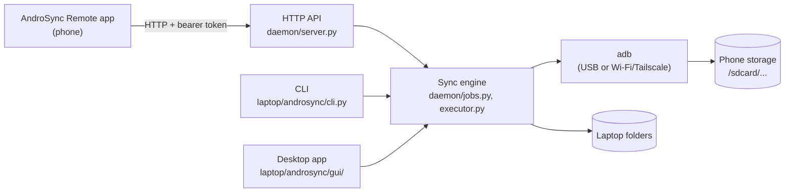

# androsync

[](https://github.com/Abdoh-Abqr/androsync/actions/workflows/ci.yml)
[](https://github.com/Abdoh-Abqr/androsync/releases)
[](LICENSE)

Keeps folders you choose identical between your devices (currently Linux and Android), in either direction, over the USB cable or over the internet via Tailscale. Start a sync from the phone app, the desktop window, or the command line. Nothing is uploaded to any cloud - the laptop and the phone talk to each other directly.

[](https://buymeacoffee.com/abqr)

AndroSync is free and open source. If it saves you time, a coffee helps keep it going.

## Part 1 - For users (start here)

### What you need

- A Linux computer: a laptop, a desktop PC or a server. Ubuntu 22.04 or newer, Debian 12 or newer, Fedora or
  Arch all work; any Linux with systemd, Python 3.10 or newer and `adb` will do. macOS and Windows are not supported yet.
- An Android phone, Android 11 or newer, with a USB cable.
- About 15 minutes.
- Optional: [Tailscale](https://tailscale.com) installed on both, if you want to sync while away
  from home over the internet instead of only over the cable.

### Before you start: turn on USB debugging

This is the one thing androsync needs that most people have never touched. It is the only way a
PC can read file timestamps and write files on the phone's storage - without it there is no sync.

On the phone: **Settings → About phone → tap "Build number" seven times** (this unlocks Developer
options) **→ Settings → Developer options → USB debugging → on**.

The first time you plug the laptop in, the phone asks "Allow USB debugging?" - tick **"Always
allow from this computer"** and accept. After that, plugging the cable in is enough; you will not
see that prompt again for this laptop.

> **Cannot or do not want to use USB debugging?** Use [agent mode](docs/agent-mode.md): the app itself does the file work
> over Tailscale, so no cable and no debugging are needed, and you keep preview, undo and the Stop button. It needs the
> `full` app (GitHub, F-Droid; not Google Play) and the "All files access" permission.

### Install on the Linux computer

The computer can be a laptop, a desktop PC or a server. Full guide: **[docs/install.md](docs/install.md)**. Steps:

1. Install the packages, then run `pipx ensurepath` and open a new terminal:
   - Ubuntu or Debian: `sudo apt install pipx adb python3-tk`
   - Fedora: `sudo dnf install pipx android-tools python3-tkinter`
   - Arch: `sudo pacman -S python-pipx android-tools tk`

   (`python3-tk` is only for the desktop window; a server does not need it.)
2. Install AndroSync: download the newest wheel from the
   [Releases page](https://github.com/Abdoh-Abqr/androsync/releases) and run `pipx install ./androsync-*.whl`.
   From a clone of this repository, run `pipx install ./laptop` instead.
3. Create the settings, a token and the background service file: `androsync service install`.
4. **Computer with a screen:** run `androsync service install-launcher`, open **"AndroSync"** from your app grid and press
   **"Run here"**. The status line should change to "Running here (this window)".
5. **Server or any computer without a screen:** there is no window. Run `androsync service install --autostart`
   instead, then `androsync qr` and scan the code with the phone. A server cannot use the phone's cable unless the phone
   is plugged into that server, so use [agent mode](docs/agent-mode.md) over Tailscale, or plug the phone in.
6. Check: `androsync service status` says the service is running, and `androsync --version` prints the version.

(`pipx` keeps AndroSync in its own isolated environment and puts a stable `androsync` command on your `PATH`.)

### Install on the phone

Download the APK from the [Releases page](https://github.com/Abdoh-Abqr/androsync/releases) (or build it, see
[Part 2](#part-2---for-developers)). There are two apps, so **which version do I install?**

| Version | Install it if | Where it will be |
|---|---|---|
| `play` | You sync with USB or Wi-Fi debugging and want the app with the fewest permissions. | Google Play (later), GitHub Releases |
| `full` | You also want [agent mode](docs/agent-mode.md): sync without USB debugging. | GitHub Releases, F-Droid |

The `full` version adds the "All files access" permission and the agent. You can have only one of them on a phone. To
switch, uninstall one first (the app keeps only the laptop address and token). Install the downloaded APK by opening it
on the phone, or from the laptop:

```sh
adb install -r androsync-remote-<version>-full.apk
```

or copy the file to the phone and open it there. Then:

1. Open the AndroSync Remote app.
2. On the Linux computer, run `androsync qr` - it prints the connection token and a scannable QR code.
3. In the app's Setup screen, scan it (or type the token and URL by hand).
4. The connection badge at the top of the app should turn **"USB"**.

### Your first folder pair

1. Tap **"+"** on the Pairs screen.
2. Pick the phone folder with the phone's own folder picker, and the laptop folder the same way.
3. Choose a direction. Three common choices:
   - **Photos**: phone → laptop only (a one-way backup; nothing is ever deleted on the phone).
   - **An Obsidian vault, or any folder you edit from both devices**: both ways.
   - **Music you only ever add from the laptop**: laptop → phone only.
4. Tap **Preview** and read the list of what would happen - nothing changes yet.
5. Tap **Sync**.

The very first sync of a pair never deletes anything, even on a two-way pair - it only copies, so
two folders that already both have content get merged rather than one side wiping the other.

### Everyday use

- Plug the phone in and tap **Sync** (in the app, the desktop window, or `androsync run <pair>`).
- The phone app's Quick Settings tile and home-screen widget can start a sync without opening the
  app at all.
- Away from home: with Tailscale running on both devices, the app's "Remote" preset reaches the
  laptop the same way, no cable needed.
- Unsure what a sync will do? Tap **Preview** first - it is always safe, nothing is changed.

### When something looks wrong

Where to look: the Job screen (phone app) or the Log panel (desktop window) show the live log of
the sync that just ran; `androsync service logs` follows the background service's own log.

- **A real conflict** (the same file changed on both sides since the last sync) never silently
  picks a winner and throws the loser away - the losing version is saved into a conflicts folder
  you can get back with "Restore" (app) or `androsync conflicts restore` (terminal).
- **Synced the wrong thing, or want last time back?** "Undo last sync…" (app and desktop window)
  or `androsync undo <pair>` puts both sides back exactly how they were before that run.
- **Old duplicate files from before this feature existed?** `androsync conflicts clean <pair>`
  finds and removes them (dry run first, `--yes` to apply).

Three common errors:

| Message | Fix |
|---|---|
| `unauthorized` | Accept the "Allow USB debugging?" prompt on the phone screen (it can be hidden behind other windows). |
| `no device found` | Check the USB cable, that USB debugging is on, or that Tailscale is connected on both ends. |
| `busy` / "a sync is already running" | Open the job that is already running instead of starting a new one. |

### Good to know / limits

- The first sync of any pair only ever copies, never deletes - see above.
- Several phones and several laptops work: each phone keeps its own history per pair, a pair can be bound to one phone, and the app holds a list of laptops (see [docs/several-devices.md](docs/several-devices.md)). One sync runs at a time on a laptop.
- Linux only, for the computer side. macOS and Windows are planned ([issue 8](https://github.com/Abdoh-Abqr/androsync/issues/8), [install guide](docs/install.md)).
- There will never be an iPhone version: iOS has no ADB and no way for a PC to read or write its
  files directly, which this design depends on.

## Part 2 - For developers

### How the pieces fit



The phone app has no file access of its own - it only ever talks to the laptop's HTTP API, which
runs the actual sync through `adb`. The CLI and the desktop GUI can drive the same engine directly
(no daemon required) or through the same API when one is already running, so a sync started from
any of the three shows up the same way everywhere.

One line each, with the full detail:

- **`laptop/`** - the Python package (`androsync`): sync engine, CLI, HTTP daemon, Tk desktop app.
  See [`laptop/README.md`](laptop/README.md).
- **`android/`** - the Kotlin/Compose phone app ("AndroSync Remote"). See
  [`android/README.md`](android/README.md).
- **[`docs/architecture/`](docs/architecture/README.md)** - the architecture: context, containers, components,
  data, behavior (flows, sequences, states), security and known gaps, as Mermaid diagrams.
- **[`CODE_INDEX.md`](CODE_INDEX.md)** - a one-line-per-file map of the whole codebase.

### Project docs and history

- **[`PLAN.md`](PLAN.md)** - architecture, the config format, the full HTTP API.
- **[`docs/install.md`](docs/install.md)** - installing AndroSync on a Linux computer, with the status for macOS and Windows.
- **[`docs/auto-sync.md`](docs/auto-sync.md)** - sync by itself when files change: how to turn it on, what it never does.
- **[`docs/support.md`](docs/support.md)** - something wrong? how to make a log file (nothing private in it) and report it.
- **[`docs/token.md`](docs/token.md)** - what the token is, where it is stored, how to make a new one.
- **[`docs/agent-mode.md`](docs/agent-mode.md)** - sync without USB debugging through the app itself: the permission, why it is not on Google Play, setup.
- **[`docs/syncthing.md`](docs/syncthing.md)** - a how-to for keeping photos, a notes vault and an inbox in sync with Syncthing instead.
- **[`NEXT_TASKS.md`](NEXT_TASKS.md)** - what was built, when, and why; read this first if you are
  picking up a task here (an AI coding agent or a human).

Run both test suites:

```sh
cd laptop && pip install -e ".[dev]" && pytest
cd android && ./gradlew :app:testDebugUnitTest
```

## License

Copyright (C) 2026 Abdoh-Abqr. [GPL-3.0-or-later](LICENSE). Free software: you may use, study, change and share it,
and anything you distribute based on it must stay under the same license.

If androsync is useful to you, you can [buy the developer a coffee](https://buymeacoffee.com/abqr). It is optional.
