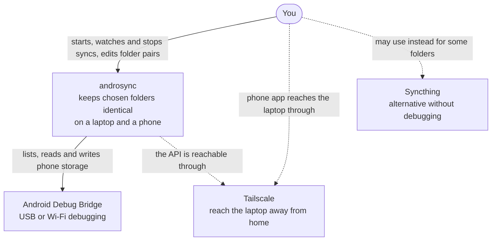
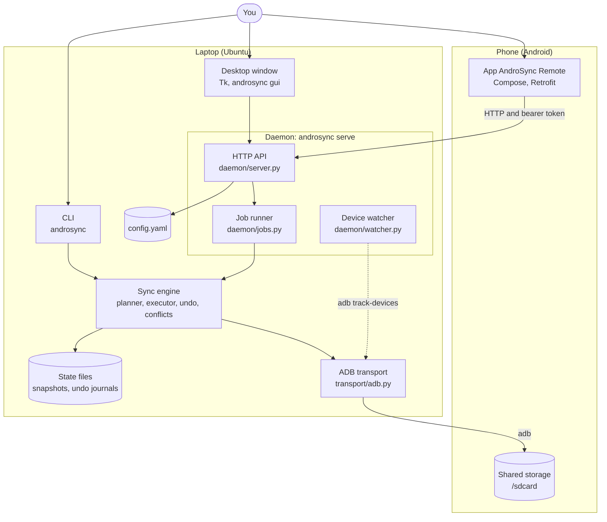
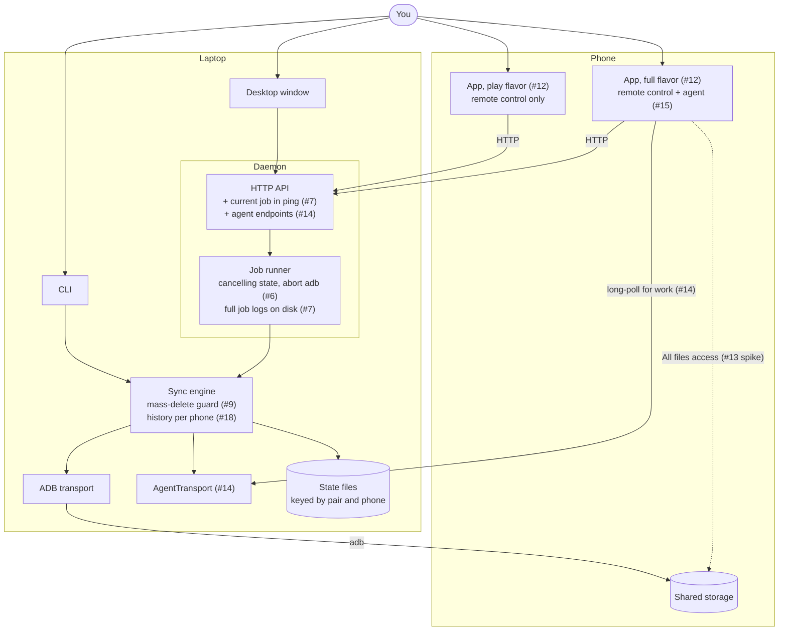
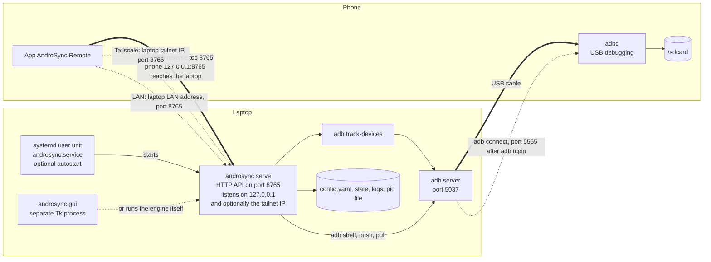

# androsync architecture

How the system is built, drawn from the code as of 2026-10-16. Every name in the diagrams exists in the repo;
`CODE_INDEX.md` is the file-by-file map, `NEXT_TASKS.md` the history of each task.

## Reading guide

| Question | Read |
|---|---|
| What is the system, who and what is around it, what runs where? | This file |
| What is inside the engine, the daemon and the app? Which classes carry the data? | [components.md](components.md) |
| Where does data move, what is stored, in which files? | [data.md](data.md) |
| What happens step by step, and which states exist? | [behavior.md](behavior.md) |
| Who can do what, how is it secured, why was it built this way, what is still weak? | [overview.md](overview.md) |

**Legend.** Diagrams are marked **as built** (matches the code today) or **target** (planned in
`NEXT_TASKS.md`, with the issue number). Solid arrows are calls or data, dashed arrows are optional or background
links. Stadium shapes are people, cylinders are stored data, rounded boxes are programs.

## 1. System context (C4 level 1, as built)

## 2. Containers (C4 level 2, as built)

Notes:
- The window talks to the daemon only when one is running; otherwise it runs the engine directly
  (`gui/backend.py`, `reachable_client`). Pair add, edit and remove always go straight to `config_edit`.
- The app never touches files. All file work happens on the laptop through ADB.

## 3. Containers (C4 level 2, target)

What the open epics change. Issue numbers are in the private repo `Abdoh-Abqr/androsync`.

## 4. Deployment (as built)

Which programs run where, on which port, and the three ways the phone reaches the laptop.

Connection paths, in the order the app tries them (`ConnectionProbe`): USB, then Tailscale (if a URL is saved), then
LAN (if a URL is saved). Only the first one that answers `GET /v1/ping` becomes the active client.
Files the laptop writes are listed in [data.md](data.md).
