# Behavior

Decisions, step-by-step flows and states. **As built** unless a heading says **target**. Back to the
[architecture index](README.md).

## 1. What the planner decides for one file

`planner.plan` looks at every path found on either side or in the last snapshot. Hashing is asked for only when both
sides changed, the sizes are equal and the times differ by more than `mtime_tolerance_s`.

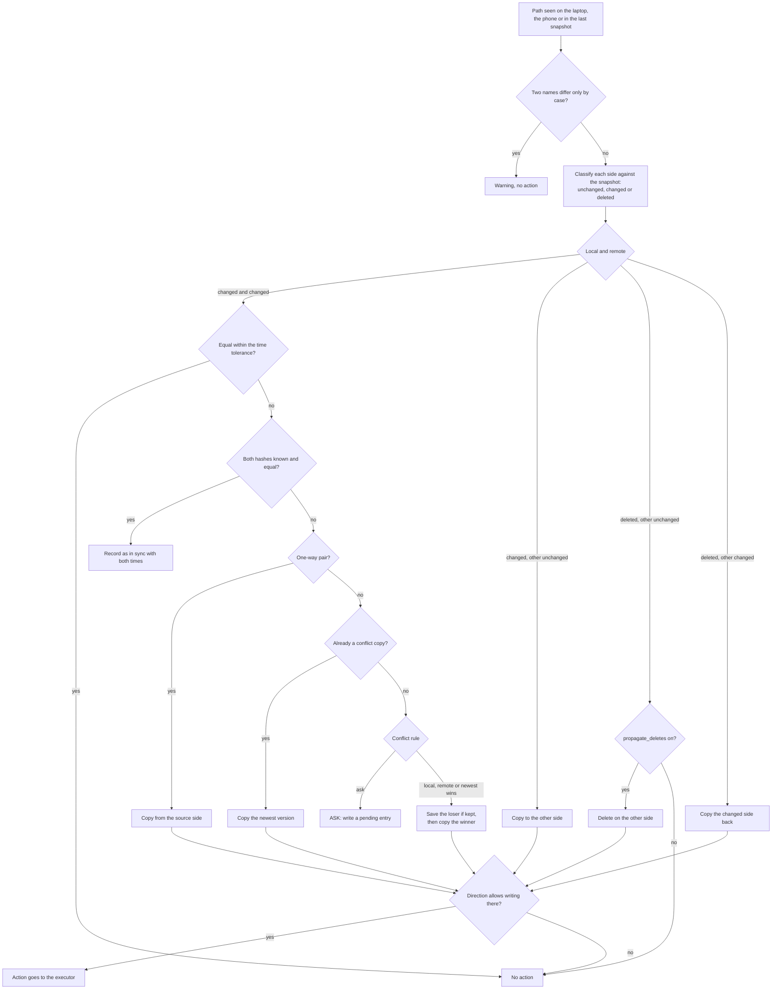

## 2. What `run_pair` does

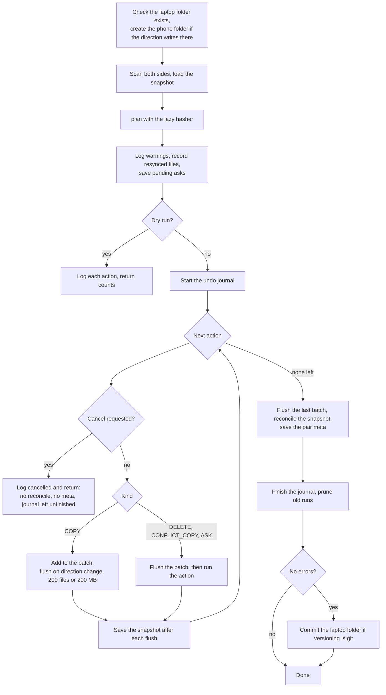

A failing action is logged and counted in `errors`; the loop carries on with the next one.

## 3. Start, follow and stop a sync from the app

### 3a. As built

Stop moves the job to `cancelling` at once and kills the adb call that is running, so even a long transfer or scan
ends within seconds. Any other device sees the running sync through the ping, section 3b.

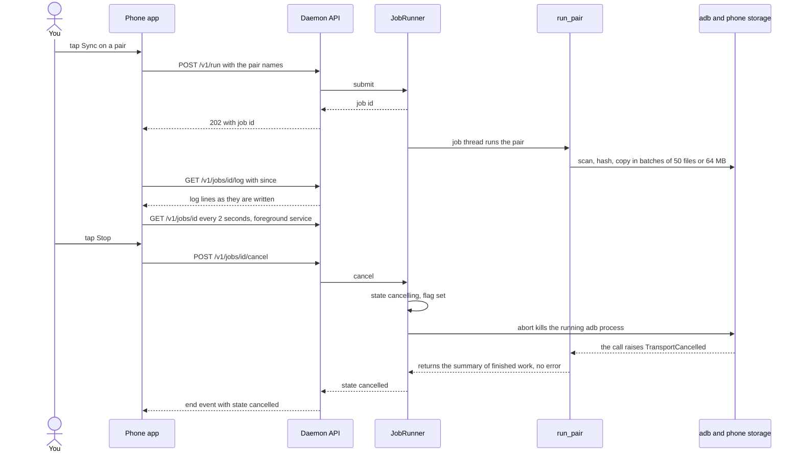

Files are pushed to a hidden `.androsync/incoming/` folder on the phone and moved into place only when complete, so a
Stop never leaves a half-copied file in the synced folder.

### 3b. Any device sees and stops the running sync (built in #7, except log files on disk)

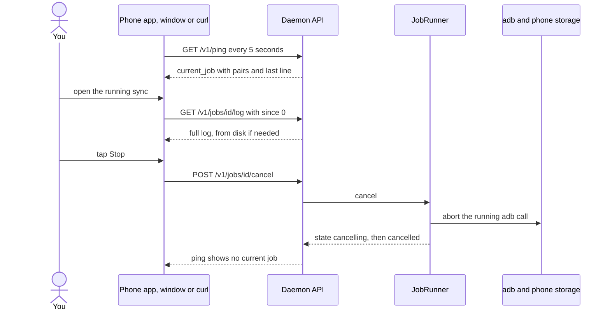

## 4. First connection and the 5 second ping

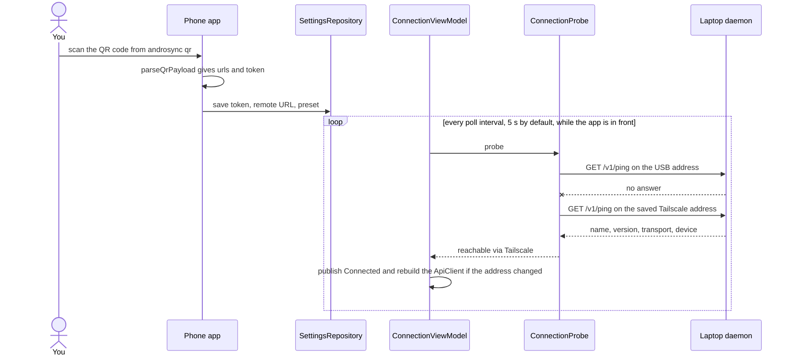

## 5. Phone plugged in

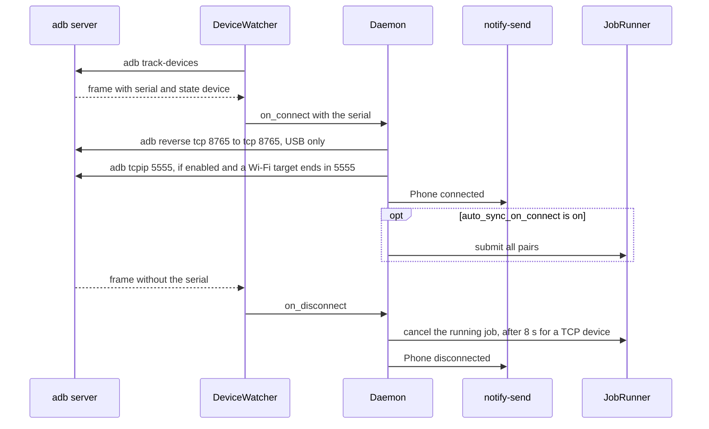

## 6. Undo a run

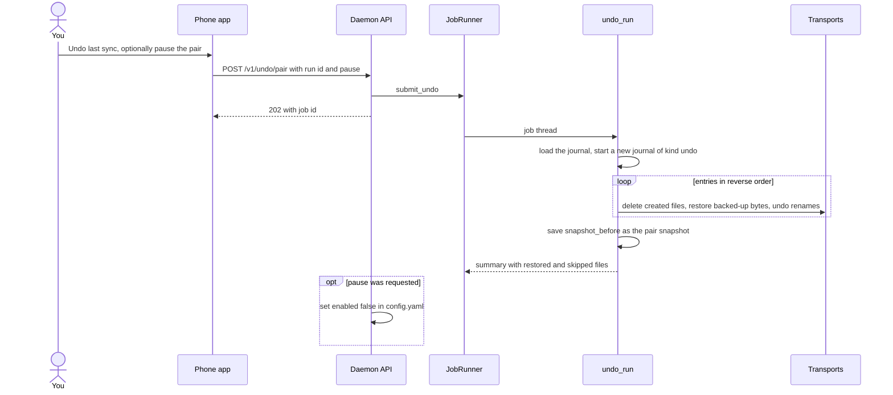

Files that changed after the run are skipped unless `--force` or the force flag is sent. Undoing an undo is a redo,
because the undo is journaled like any run.

## 7. A real conflict

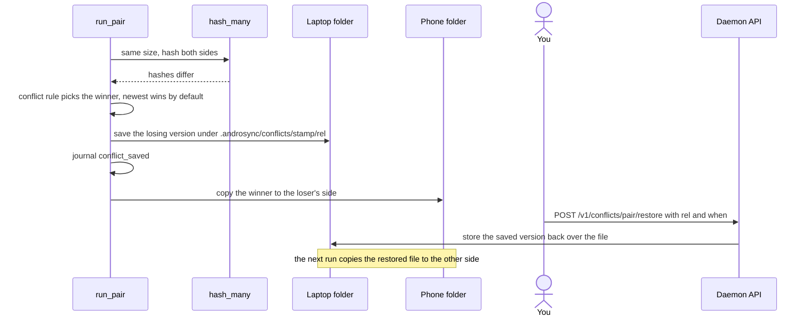

`conflicts clean` removes old `name.conflict-...` copies: if the copy equals the original it is deleted on both sides,
otherwise it is archived into the conflicts folder first.

## 8. Desktop window: run here and close

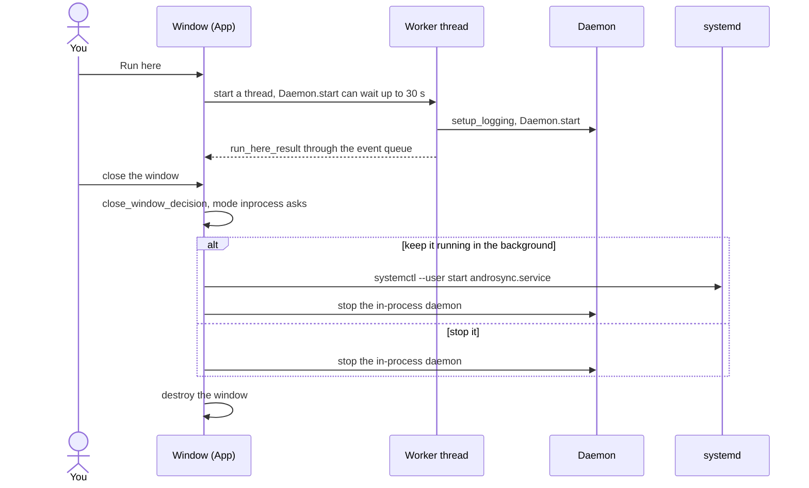

For any other service mode the window just closes and leaves things as they are.

## 9. States

### 9a. Job (as built)

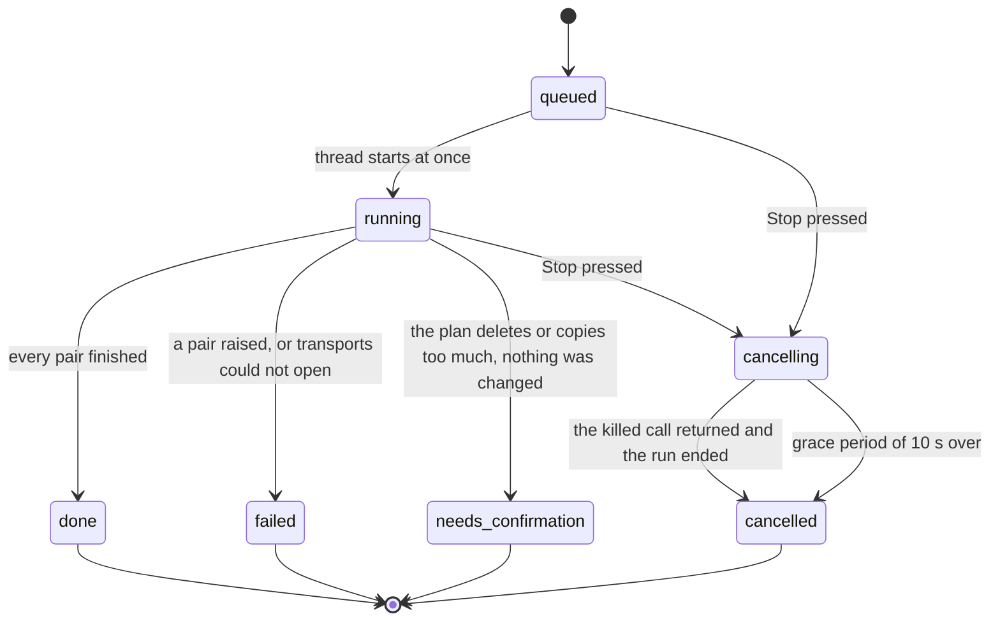

`cancelling` still counts as busy: a new sync answers 409 until the job has ended. `needs_confirmation` is final: the
user then starts a new job for the blocked pairs with `confirm_large: true` ("Go ahead").

### 9b. Connection state in the app

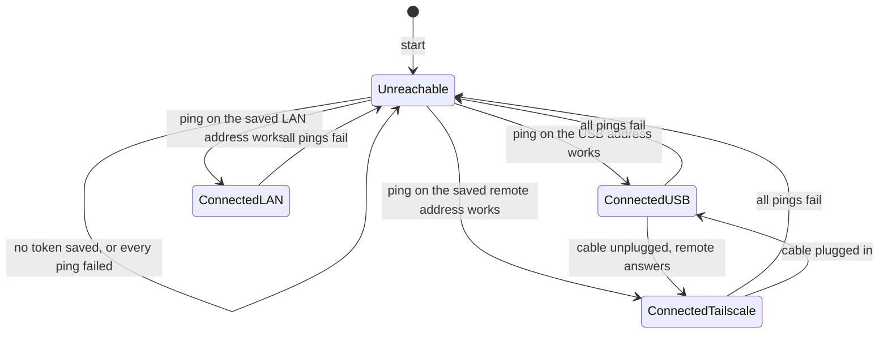

Polling runs only while the app is in front (`ON_START` to `ON_STOP`); the last state is frozen otherwise.

### 9c. How the service is running (`detect_state`)

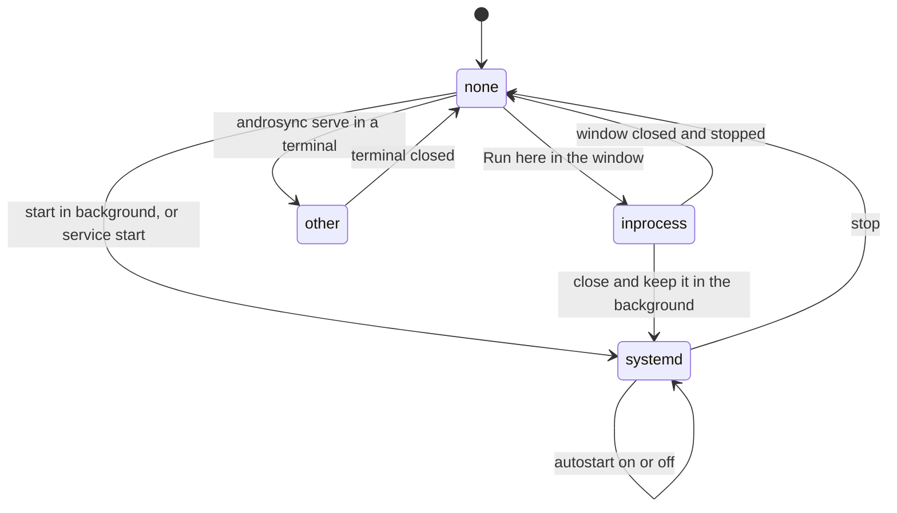

Detection order: `systemctl --user is-active` first, then the pid file plus a ping (pid equal to the current process
means `inprocess`, otherwise `other`), else `none`.

### 9d. A pair

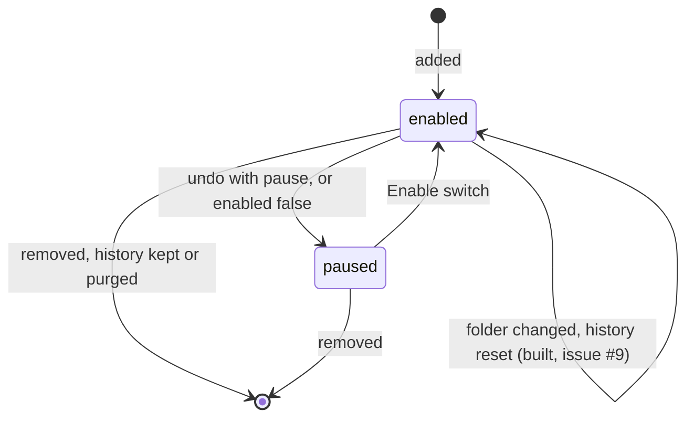
