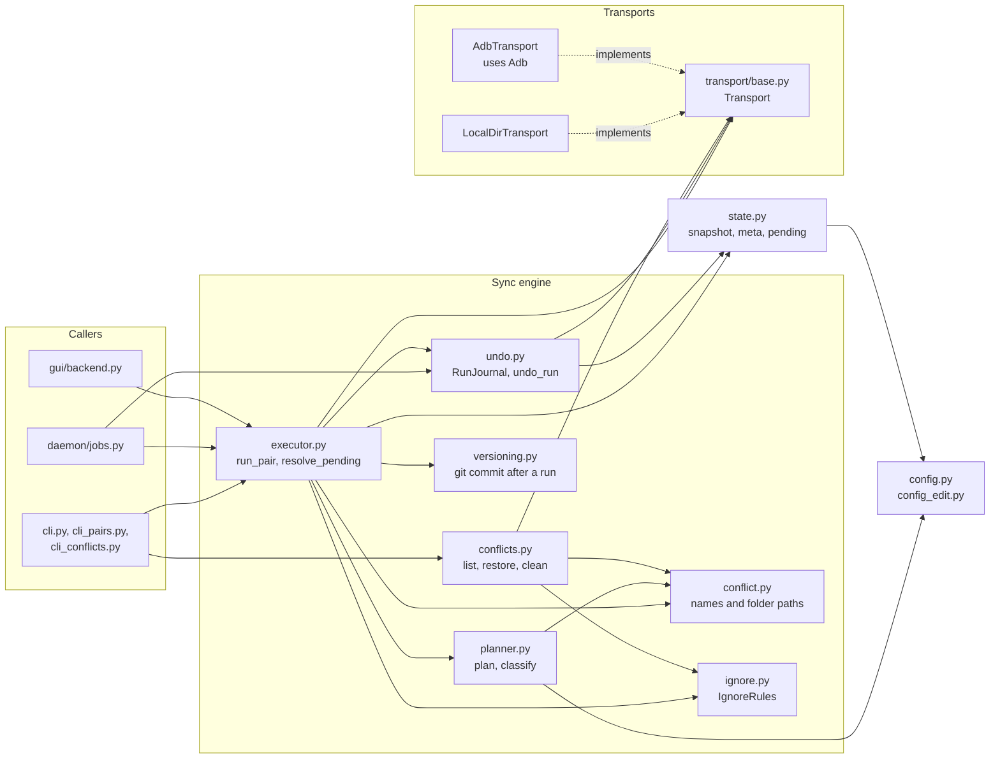
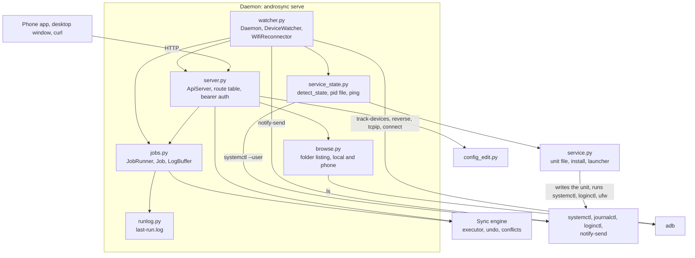
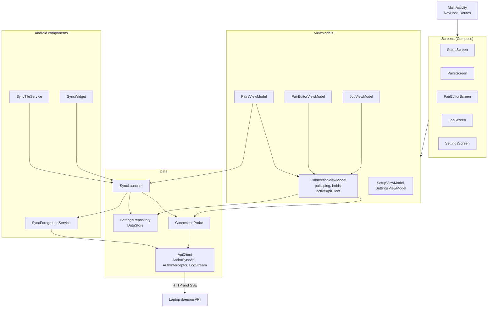
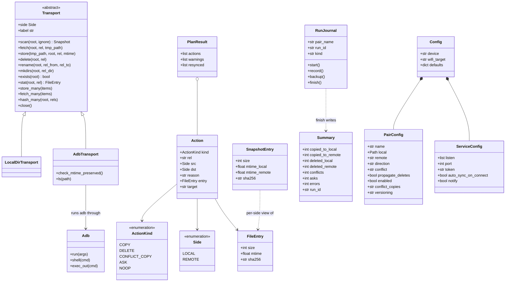
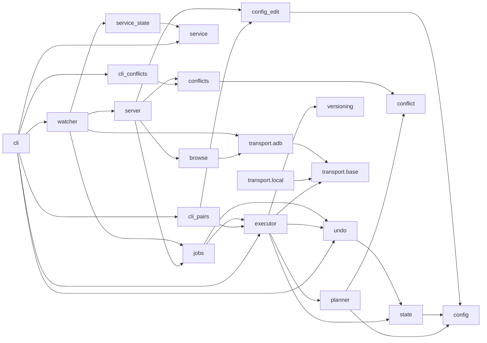

# Components

What is inside each container, and the classes that carry the data. All diagrams are **as built** (2026-10-16).
Back to the [architecture index](README.md).

## 1. Sync engine (C4 level 3)

The engine is plain Python with no network code. It only talks to the two sides through the `Transport`
interface, which is why tests run it on two local folders.

## 2. Daemon (C4 level 3)

Threads in a running daemon: one `androsync-api-<addr>` per bound address, `androsync-watcher`,
`androsync-wifi-reconnect` (only for a `wifi:` device), one `androsync-job-<id>` per job, and short-lived timers for
the TCP disconnect grace period.

## 3. Android app (C4 level 3)

Wiring is a hand-written container: `AndroSyncApplication` creates one `AppContainer` that holds
`SettingsRepository`, `ConnectionProbe` and `SyncLauncher`. The tile, widget and foreground service reach it through
the application context. There is no dependency injection library.

## 4. Core classes (as built)

`Snapshot` is a dict from relative path to `FileEntry` (what a scan returns). `PersistedSnapshot` is a dict from
relative path to `SnapshotEntry` (what is saved between runs, with one modified time per side).

## 5. Module dependencies

An arrow means "imports". `cli` reaches the sub-command modules both ways, lazily, to avoid a cycle.

