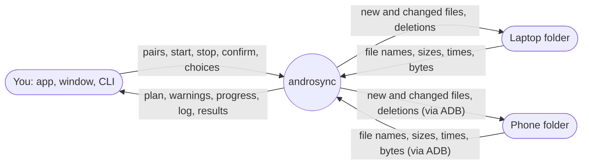
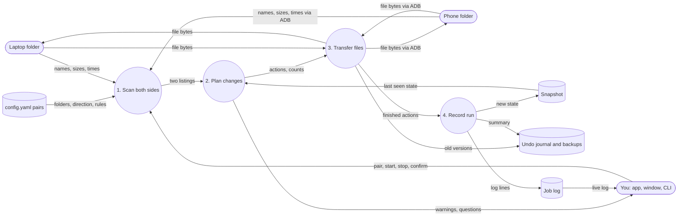
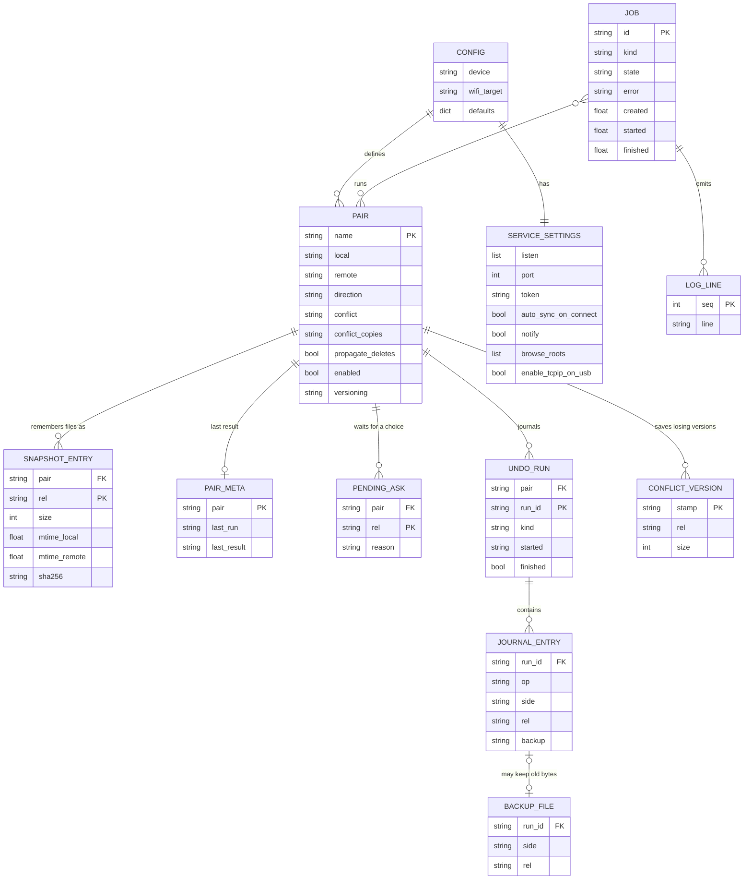

# Data

Where data moves, what is stored, and in which files. **As built** (2026-10-16). Back to the
[architecture index](README.md).

## 1. Data flow, level 0

Nothing leaves the two devices and the link between them. There is no cloud service and no telemetry.

## 2. Data flow, level 1

## 3. Stored data (ER)

Everything persistent is a file; there is no database. The two entities marked in memory are not written to disk.

`JOB` and `LOG_LINE` live in memory (the daemon keeps 50 jobs and a 5000-line ring buffer per job). The log is also
copied line by line into `last-run.log`, which is overwritten at the start of each run.

## 4. Data dictionary

`<state>` is `$XDG_DATA_HOME/androsync/state`, default `~/.local/share/androsync/state`. Every JSON file is written
to a `.tmp` file and renamed, so a crash never leaves half a file.

| Data | Path | Shape | Written by | Read by |
|---|---|---|---|---|
| Config | `~/.config/androsync/config.yaml` | See section 5 | `config_edit.save_raw` (validates first), `service install` | `config.load_config` |
| Snapshot | `<state>/<pair>.json` | `{rel: {size, mtime_local, mtime_remote, sha256}}`. Old files with one `mtime` are migrated on read. | `executor.run_pair` after every action, `resolve_pending`, `undo_run` | executor, undo |
| Pair meta | `<state>/<pair>.meta.json` | `{last_run, last_result, summary}` | end of a real run, failed jobs (`FAILED: ...`) | `pairs_status`, CLI |
| Pending asks | `<state>/<pair>.pending.json` | list of `{rel, local, remote, reason}` | `executor._save_pending_asks` after each plan | `resolve`, `GET /v1/pending` |
| Undo run | `<state>/undo/<pair>/<run_id>/meta.json` | `{pair, run_id, kind, started, finished, summary}` | `RunJournal.start` and `finish` | `undo.list_runs` |
| Snapshot before | `.../<run_id>/snapshot_before.json` | same shape as the snapshot | `RunJournal.start` | `undo_run` restores it |
| Journal | `.../<run_id>/journal.jsonl` | one JSON line per change, see below | `RunJournal.record*` | `undo.load` |
| Backed-up bytes | `.../<run_id>/files/<local or remote>/<rel>` | raw file | `RunJournal.backup` | `undo_run` |
| Saved conflict version | `<laptop folder>/.androsync/conflicts/<YYYYMMDD-HHMMSS>/<rel>` | raw file, laptop only | `executor._do_conflict_copy` | `conflicts.list_conflicts`, `restore` |
| Beside-mode conflict copy | next to the original, on both sides | `name.conflict-<laptop or phone>-<stamp>.ext` | `_do_conflict_copy` (option `beside`) | `conflicts.find_duplicates` |
| Run log | `~/.local/state/androsync/last-run.log` | text, truncated per run | `runlog.RunLog` | humans |
| Daemon log | `~/.local/state/androsync/daemon.log` | rotating, 2 MB, 3 backups | `cli.setup_logging` | `service logs`, window |
| Pid file | `$XDG_RUNTIME_DIR/androsync/daemon.pid` | pid | `Daemon.start` | `service_state.detect_state` |

Journal operations (`side` is `local` or `remote`):

| `op` | Keys | Undone by |
|---|---|---|
| `create` | `side, rel, new{size,mtime}` | deleting the file, unless it changed since |
| `overwrite` | `side, rel, old, new, backup` (`saved` or `skipped`) | restoring the backed-up bytes |
| `delete` | `side, rel, old, backup` | restoring the backed-up bytes |
| `conflict_saved` | `path` | deleting the saved version |
| `conflict_rename` | `side, rel, target, old` | renaming back |

## 5. Config schema

Top-level keys: `device` (default `auto`), `wifi_target`, `service`, `defaults`, `pairs`.

`service` (`ServiceConfig`):

| Key | Default |
|---|---|
| `listen` | `["127.0.0.1"]`; `0.0.0.0` is refused |
| `port` | 8765 |
| `token` | generated by `service install` |
| `auto_sync_on_connect` | false |
| `notify` | true |
| `browse_roots` | `["~"]` plus the removable-media folder if it exists |
| `enable_tcpip_on_usb` | true |

`pairs` (`PairConfig`), after `defaults` are merged underneath (only the `ignore` lists are concatenated):

| Key | Default | Allowed |
|---|---|---|
| `name` | required | unique |
| `local` | required | path, `~` and variables expanded |
| `remote` | required | must start with `/` |
| `direction` | required | `two-way`, `laptop-to-phone`, `phone-to-laptop` |
| `conflict` | `newest-wins` | `local-wins`, `remote-wins`, `ask` |
| `conflict_copies` | `folder` | `beside` |
| `keep_conflict_copies` | true | |
| `propagate_deletes` | true | |
| `mtime_tolerance_s` | 2 | |
| `ignore` | defaults plus pair list | `.androsync/**` is always ignored |
| `versioning` | none | `git` |
| `enabled` | true | |
| `undo.keep_runs`, `undo.max_total_mb`, `undo.max_file_mb`, `undo.enabled` | 10, 2048, 500, true | merged as built-in, then `defaults.undo`, then the pair's `undo` |
| `transfer.batch_files`, `transfer.batch_mb` | 50, 64 | files and MB per batched copy (same merge order) |
| `safety.max_delete_count`, `safety.max_delete_percent`, `safety.big_first_run_files`, `safety.big_first_run_gb` | 50, 20, 5000, 5 | when a plan needs confirmation; 0 switches a check off (same merge order) |
