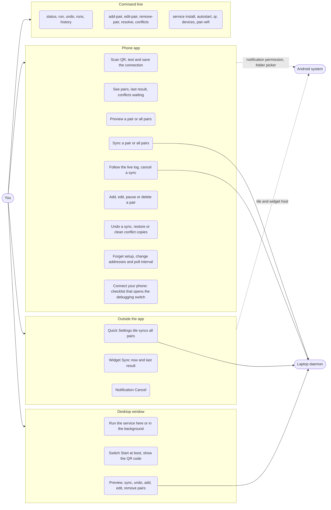

# Overview: actors, safety, decisions and known gaps

Back to the [architecture index](README.md). **As built** (2026-10-16) unless marked target.

## 1. Who can do what (use cases)

## 2. Security

| Topic | How it works today |
|---|---|
| Who may call the API | Every route needs `Authorization: Bearer <token>`, compared with `hmac.compare_digest`, even on `127.0.0.1`. Wrong or missing token gives 401. |
| Where the API listens | `service.listen`, default `127.0.0.1`. A Tailscale address can be added by `service install`. `0.0.0.0` is refused. |
| Firewall | `service install --ufw` adds one rule: `allow in on tailscale0` for the API port. The USB path needs no rule. |
| Plain HTTP | The app allows cleartext because the three paths are loopback over `adb reverse`, the encrypted tailnet, or the home LAN; the token is the protection. A LAN address sends the token unencrypted on that network. |
| Phone access | ADB authorisation on the phone ("Always allow from this computer"). The app itself has no storage permission. |
| Token storage | In `config.yaml` on the laptop and in the app's private settings store. |
| Personal data in the repo | `scripts/check_no_personal_data.sh` fails on tailnet addresses, device serials and host names. |

## 3. Safety of user files

| Mechanism | Effect |
|---|---|
| First run never deletes | With no snapshot, a file on one side is copied, never removed. |
| Hash before conflict | Same size on both sides and equal hash: recorded as in sync, no copy, no duplicate. |
| Per-side times | The snapshot keeps one modified time per side, so identical files with different times stay quiet. |
| Conflicts folder | The losing version is saved under `<folder>/.androsync/conflicts/<stamp>/`, on the laptop only, never synced. |
| Undo journal | Each real run records what it changed and backs up overwritten or deleted bytes (files over 500 MB are skipped and reported). `undo` replays it backwards. |
| Atomic writes | Snapshots, meta and config are written to a `.tmp` file and renamed. |
| Snapshot after every action | A crash or cancel loses at most the action in flight. |
| Optional git history | `versioning: git` commits the laptop folder after a run without errors. |
| Phone folder rules | `/Internal storage/x` becomes `/sdcard/x`; `/`, `/data` and app-private folders are refused (#8). |
| History reset on folder change | Changing a pair's laptop or phone folder moves its snapshot aside, so the next sync only adds files (#9). |
| Confirmation for big plans | More than 50 deletes and 20 percent on one side, or a first run over 5000 files or 5 GB, stops before any change until confirmed (#9). |

## 4. Concurrency

| Thing | Rule |
|---|---|
| Jobs | One at a time. `JobRunner.submit` raises `JobBusy`, the API answers 409 with the running job id. |
| Dry run (`GET /v1/status/<pair>`) | Also answers 409 while any job runs, so two ADB sessions never overlap. |
| Cancel | Moves the job to `cancelling`, kills the running adb call and sets a flag checked between actions and pairs; ends as `cancelled` within seconds (task 36a, #6). |
| Log | One ring buffer per job, 5000 lines, guarded by a condition so the SSE stream can wait for new lines. |
| Threads | One API thread per bound address, `androsync-watcher`, `androsync-wifi-reconnect`, one `androsync-job-<id>` per job, grace timers. |
| Window | Tk on the main thread; every slow call on a worker thread; results come back through a queue polled every 150 ms. |

## 5. Decisions

| Decision | Why | Consequence |
|---|---|---|
| ADB as the transport | The only way for a PC to read timestamps, hash and write `/sdcard` | Needs USB or Wireless debugging. Alternatives: Syncthing, or an in-app agent (target, #14, #15) |
| App is a remote control, laptop does the work | No storage permission in the app; one engine for app, window and CLI | The laptop must be on and reachable |
| HTTP API plus `adb reverse` | Phone reaches the laptop over USB without a network | Port 8765 on the laptop; Tailscale or LAN for remote use |
| State-based sync with a snapshot | Tells "deleted" from "never existed", needs no server | History is per pair name today; per phone later (#18) |
| Hash before declaring a conflict | Hand-copied files have the same bytes but different times | Hash of conflict candidates costs one batched call per side |
| Conflicts folder, not beside copies | Beside copies duplicated files in synced folders | A saved version is found through `conflicts list`, the app or the API |
| Undo journal per run | A wrong sync must be reversible | Backups use disk (default cap 2 GB per pair) |
| Tk window shares the engine | One desktop app for service control and pairs | Two code paths to the same actions (see gaps) |
| GitHub Issues and Projects, Kanban | Solo project, public repo, no deadline | See `docs/planning/PLAN.md` |
| `play` and `full` app flavors (built, #12) | Google Play restricts the all-files permission an agent needs | Two builds from one code base |

## 6. Known gaps found while mapping

| Gap | Effect | Tracked |
|---|---|---|
| ~~The window waited on the state `error` but the daemon's failing state is `failed`~~ fixed | - | #27 (done) |
| ~~Cancel was cooperative only~~ fixed in #6: Stop kills the running adb call | - | #6 (done) |
| ~~`/v1/ping` had no current-job field~~ fixed in #7. Job logs still live in memory only | A daemon restart loses old logs (50 jobs x 5000 lines are kept while it runs) | #7 (rest) |
| ~~Editing a pair's folders kept the old snapshot~~ fixed in #9: the history is reset, and a plan that deletes or copies too much waits for confirmation | - | #9 (done) |
| ~~Phone folders were not validated~~ fixed in #8 | - | #8 (done) |
| The window adds, edits and removes pairs and browses the phone without the API | Two code paths for one action; safe today because config writes are atomic | not tracked, low risk |
| The app keeps the last `ApiClient` when the laptop becomes unreachable | Calls may still be attempted and fail with a clear error | intended, documented here |
| `queued` is almost never visible | The job thread sets `running` immediately | cosmetic |
| One phone per laptop, one laptop per app | Second device needs a separate setup | #18 to #21 |
